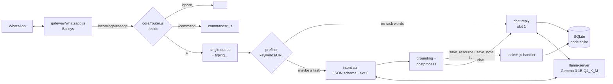

# Pocket AI 📱🧠

**A WhatsApp AI assistant that runs 100% on an Android phone.** The WhatsApp connection, the bot logic and the language model (Gemma 3 1B via llama.cpp) all run inside Termux on a realme Narzo 70 Pro. No cloud and no API keys. Messages never leave the phone.

Send it a link and it understands that you want it saved. Ask it something and it chats. Add it to a group and it behaves like Meta AI, but it's yours and it's offline.

```
You:     saw this blog on agents https://lilianweng.github.io/posts/2023-06-23-agent/ for pocket-ai
Pocket:  📌 Saved link (#12)
         Topic: *agents*
         Project: *pocket-ai*

You:     yaad rakhna ki friday ko demo hai
Pocket:  📝 Noted (#7): friday ko demo hai

You:     hinglish me batao, quantization kya hai?
Pocket:  Quantization matlab model ke weights ko chhote numbers me store karna…
```

---

## Highlights

- **Fully on-device.** `llama-server` (llama.cpp, built with `-mcpu=native` for the phone's ARM cores) runs alongside a Node.js WhatsApp client ([Baileys](https://github.com/WhiskeySockets/Baileys), no browser).
- **Two-stage router.** A fast *classify + extract* call with **grammar-constrained JSON** (always valid) decides the intent. Only plain chat goes to a second, free-form generation.
- **Plain code first.** Group triggers, commands, permissions, rate limits, URL extraction and a keyword prefilter don't use the model. About 25% of messages never touch it.
- **"Model proposes, code verifies."** Extracted fields are *grounded*: a project name the user never typed is thrown away.
- **Prompt caching by design.** The classifier prompt prefix is identical for every message and pinned to its own llama.cpp slot. **97.7% of prompt tokens are served from cache**, so each message costs ~18 new tokens instead of ~800.
- **Measured, not guessed.** A command-line eval harness (120 labelled English and Hinglish messages) reports accuracy, F1, field accuracy and p95 latency, and **fails if a change regresses an old task.**
- **Add a feature = add one file.** Tasks (intent + schema + few-shot examples + handler) and commands load automatically.

## Architecture



| Layer | Path | What it does |
|---|---|---|
| Gateway | `src/gateway/whatsapp.js` | The **only** file that knows WhatsApp. Pairing code login, reconnect with backoff, LID→phone mapping, backlog guard, clean logout |
| Router | `src/core/router.js` | Pure `decide()` (ignore / command / deny / ai), then rate limit → queue → intent → task or chat |
| Intent | `src/intent/` | Builds the JSON schema and cached few-shot prompt from the task registry, then grounds the output |
| Tasks | `src/tasks/*.js` | `save_resource`, `save_note`, `chat` (fallback). One file each |
| Commands | `src/commands/*.js` | `/help /ping /reset /stats`, plus commands contributed by tasks (`/res`, `/notes`) |
| LLM | `src/llm/client.js` | llama-server client: `cache_prompt`, `id_slot`, `json_schema`, timings |
| Storage | `src/db/` | Built-in `node:sqlite`, so there is **no native npm module** to compile on Android |

Runtime dependencies: **`baileys` and `pino`**. That's it.

## Evaluation

`npm run eval` runs every message in `eval/datasets/*.jsonl` through the **same detector the bot uses**. The 120 cases are 40 resource, 35 note and 45 "looks like a task but is chat" negatives, tagged English, Hinglish, typo, vague and confusable.

Iterations on **Gemma 3 1B Q4_K_M** (accuracy numbers carry over to the phone; latency below is from the dev Mac, see [phone numbers](#phone-performance)):

| Run | What changed | Intent acc | Field acc | note F1 | resource F1 | chat F1 | resource.project | note.project |
|---|---|---|---|---|---|---|---|---|
| v0 | baseline prompt | 87.5% | 61.0% | 82.5% | 93.7% | 85.7% | 56.4% | 37.1% |
| v1 | grounding + better few-shot (null-project & Hinglish examples) | 90.0% | 77.2% | 87.9% | 93.7% | 88.4% | 71.8% | 80.0% |
| **v2** ✅ | stem-based Hinglish prefilter ("likhna", "bhoolna", "noted") | **91.7%** | **78.7%** | **91.2%** | **93.7%** | **90.3%** | **71.8%** | **80.0%** |
| v3 ✗ | generate `topic` before `project` | 92.5% | 79.4% | 91.2% | 95.0% | 91.3% | **64.1%** | 82.9% |

v3 improved topic (+11) but the regression check flagged project −7.7 points, and project drives how saved items are organised, so **v2 is kept**. Hinglish accuracy went from 72% to 88% between v0 and v2. The classifier outputs ~18 tokens per message, and 97.7% of each prompt is a cache hit. Full table: [`eval/RESULTS.md`](eval/RESULTS.md).

```bash
npm run eval                                         # run + save to eval/results/
npm run eval -- --baseline eval/results/baseline.json  # exit 1 if any task drops > 3 points
npm run eval -- --no-prefilter                       # measure the model alone
./eval/matrix.sh ~/models/*.gguf                     # compare models / quantizations
npm run eval:report -- --write                       # regenerate eval/RESULTS.md
```

## Phone performance

_realme Narzo 70 Pro 5G: MediaTek Dimensity 7050 (2× Cortex-A78 + 6× Cortex-A55), 8 GB RAM, CPU inference._

Fill these in from `./bench/llama-bench.sh` and `npm run eval` on the phone:

| Model | Threads | Prompt tok/s | Gen tok/s | Intent p50 / p95 | RAM |
|---|---|---|---|---|---|
| Gemma 3 1B Q4_K_M | _tbd_ | | | | |
| Gemma 3 1B Q4_0 | _tbd_ | | | | |
| Gemma 3 4B Q4_K_M | _tbd_ | | | | |

`/stats` in WhatsApp shows live numbers: gen and prompt tok/s, avg/p95 latency, cache hit %, free RAM and battery temperature.

## Quick start

**On the Mac (development):**
```bash
brew install llama.cpp
./scripts/download-model.sh 1b
cp .env.example .env        # set BOT_NUMBER, OWNER_NUMBERS
npm install
./scripts/start.sh          # llama-server + bot in tmux
npm run console             # or chat with it in the terminal, no WhatsApp needed
npm test                    # 25 unit tests, no model needed
```

**On the phone:** follow [`docs/PHONE_SETUP.md`](docs/PHONE_SETUP.md). In short: Termux from F-Droid → `git clone` → `./scripts/termux-setup.sh` → `./scripts/start.sh` → enter the pairing code in the cloned WhatsApp (realme App Clone).

## Using it

| Where | How to talk to it |
|---|---|
| Private chat | Just message it (owner + `ALLOWED_NUMBERS`; set `DM_POLICY=all` for everyone) |
| Group | `@Pocket …`, reply to one of its messages, or start with `/ai …` / `hey pocket …`. Otherwise it stays silent |

| Command | |
|---|---|
| `/help` | What it can do |
| `/res [text]` | List or search saved resources |
| `/notes [text]` | List or search notes |
| `/stats` | tok/s, latency, cache hit, RAM, battery temp, uptime |
| `/ping` | Health check |
| `/reset` | Forget this chat's history |

## Adding a task

Create `src/tasks/<name>.js`, add `eval/datasets/<name>.jsonl`, run the eval with `--baseline`. Nothing else changes.

```js
export default {
  name: 'add_expense',
  description: 'User reports money they spent ("spent 200 on lunch", "auto ka 80 diya").',
  fields: {
    amount: { type: 'number', description: 'amount in rupees' },
    category: { type: ['string', 'null'], description: 'food, travel, … else null' },
  },
  examples: [{ text: 'chai pe 40 gaye', fields: { amount: 40, category: 'food' } }],
  prefilter: (text) => /\d/.test(text),          // optional: skip the model when impossible
  migrate: (db) => db.exec('CREATE TABLE IF NOT EXISTS expenses (...)'),
  async handle(ctx, fields) { /* save */ return `💸 Added ₹${fields.amount}`; },
  commands: [{ name: 'spent', description: 'This month', run: async (ctx) => { /* … */ } }],
};
```

## Configuration

Everything lives in `.env` (see [`.env.example`](.env.example)). The main settings are `BOT_NUMBER`, `OWNER_NUMBERS`, `BOT_NAME`, `MODEL_PATH` (swap models here), `LLM_THREADS`, `LLM_CTX`, `DM_POLICY`, `HISTORY_TURNS`, `RATE_LIMIT_PER_MIN` and `INTENT_PREFILTER`.

## Roadmap

Designed for, not built yet. See [`docs/ROADMAP.md`](docs/ROADMAP.md):
- streaming replies by editing the WhatsApp message as tokens arrive
- Q4_0 vs Q4_K_M and 1B vs 4B comparisons
- fine-tuning Gemma 3 270M/1B on collected examples
- `/mode casual | savage | formal`
- **Mac bridge**: `/fix <project> <issue>` runs Claude Code headless on a new git branch over Tailscale and reports back
- voice notes (whisper.cpp) and images

## ⚠️ Disclaimer

Baileys is an **unofficial** reverse-engineered WhatsApp client. Automating a WhatsApp account breaks WhatsApp's Terms of Service, and **the number can be banned**. Use a dedicated number, don't spam, and don't use this for bulk messaging. This is a personal, educational project, not affiliated with WhatsApp or Meta.

## License

MIT
